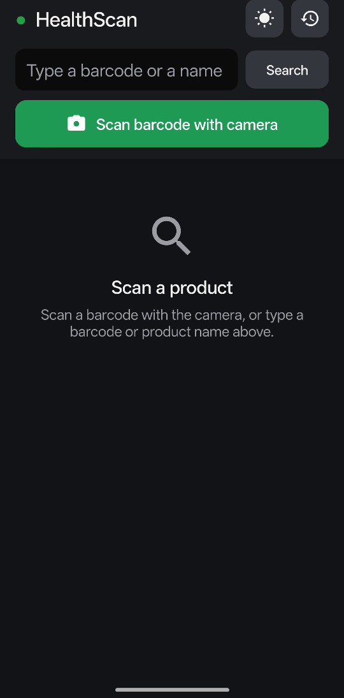
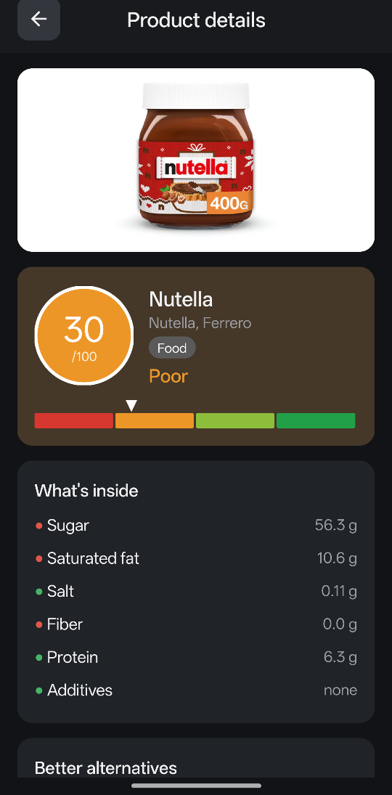
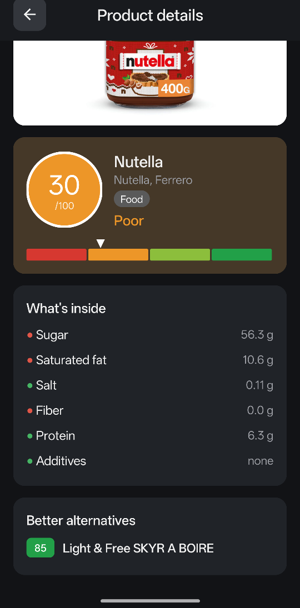
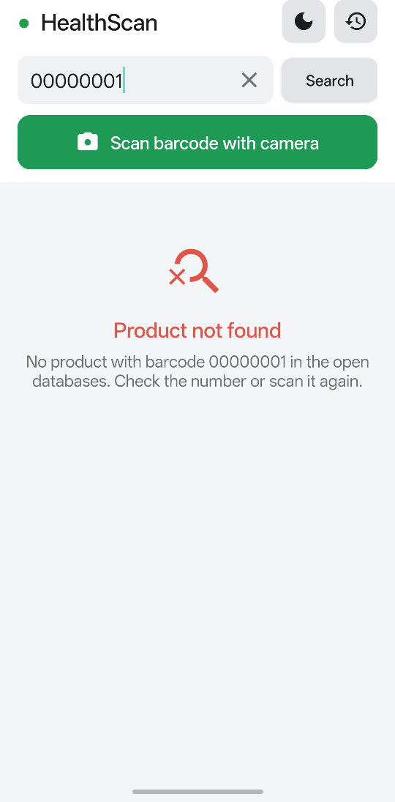
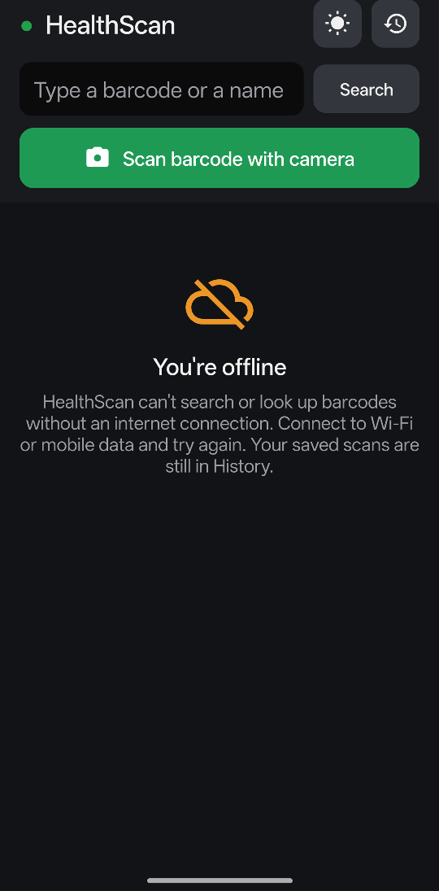
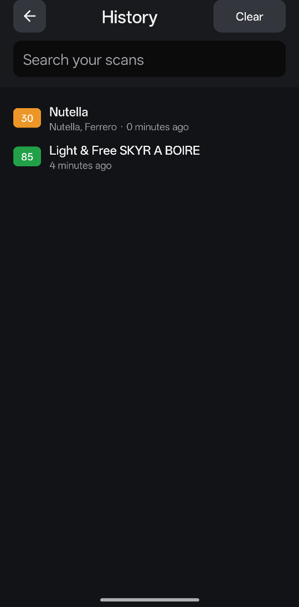

# HealthScan

An Android app that scans a food or cosmetic barcode and gives it a 0–100 health score,
explains what drives the score, and suggests healthier alternatives.

## Screenshots

| Home | Product details | Better alternatives |
|:---:|:---:|:---:|
|  |  |  |
| Scan with the camera or type a barcode or name. Theme and history are one tap away. | Each product opens on its own page with its photo, score and what's inside. | Healthier products of the same kind among your scans. |

| Product not found | Offline | Scan history |
|:---:|:---:|:---:|
|  |  |  |
| Clear message when a barcode or name has no match (light theme shown). | The home screen says when the phone is offline and searching isn't possible. | Every product you open is saved on the phone and can be searched. |

## Features

- **Barcode scanner**: point the camera at an EAN-13, EAN-8 or UPC-A code, held upright or sideways.
- **Product page**: every product opens on its own page with its photo (when the database
  has one), score, breakdown and better alternatives.
- **Health score**: 0–100 on a red → green scale (Bad, Poor, Good, Excellent).
- **Breakdown**: nutrition (sugar, saturated fat, salt, fiber, protein), additives and organic
  label for food; ingredient hazards for cosmetics.
- **Better alternatives**: products of the same kind from your scans that score at least
  15 points higher.
- **Search**: type a barcode to look it up, or a name to find it among your scans. A clear (✕)
  button empties the field.
- **Clear feedback**: loading, "product not found" and "you're offline" messages appear in the
  middle of the home screen.
- **Scan history**: searchable list of past scans, kept on the phone and available offline.
- **Light and dark themes**, portrait only.

## How products are looked up

Barcodes are looked up only when you scan or search, in the open, community-run databases
[Open Food Facts](https://world.openfoodfacts.org) and
[Open Beauty Facts](https://world.openbeautyfacts.org) (data under the ODbL, photos under
CC BY-SA). Their raw data is scored with HealthScan's own rules. See
[MECHANICS.md](MECHANICS.md) for the full scoring model and [mechanics.json](mechanics.json)
for the values.

## Requirements

- Android 7.0 (API 24) or newer
- Permissions: **Camera** (barcode scanning only), **Internet** (product lookup and photos
  only) and **Network state** (to tell you when you're offline)

## Build

You need JDK 17 or newer and the Android SDK (platform 34). Set `ANDROID_HOME`, or
create `local.properties` with `sdk.dir=/path/to/Android/sdk`.

```sh
./gradlew test            # unit tests (barcode reader, search and alternatives)
./gradlew assembleDebug   # build/outputs/apk/debug/HealthScan-debug.apk
./gradlew installDebug    # install on a connected phone
```

You can also open this folder in Android Studio.

## Project layout

```
src/main/java/com/healthscan/app/
  MainActivity.java      home screen (search, messages) and history list
  ProductActivity.java   product page: photo, score, breakdown, alternatives
  ScannerActivity.java   camera preview and barcode scanning
  BarcodeDecoder.java    reads barcodes from camera frames (ZXing)
  OpenFacts.java         Open Food / Beauty Facts lookup
  ImageLoader.java       downloads and caches product photos
  Network.java           online / offline state
  Finder.java            search and better-alternative rules
  Scoring.java           health score rules
  History.java           saved scans
  Product.java           product model
  ScoreViews.java        score disc and color scale
  Ui.java                theme colors and shared view helpers
src/main/res/drawable/   vector icons
src/test/java/           JUnit tests
```

## Credits

See [CREDITS.md](CREDITS.md). Product data and photos in the screenshots come from
Open Food Facts contributors.
