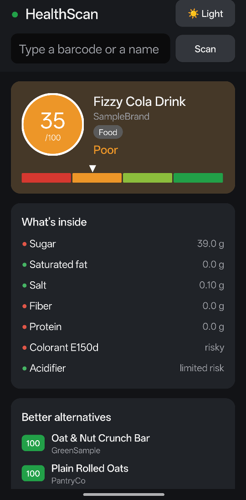
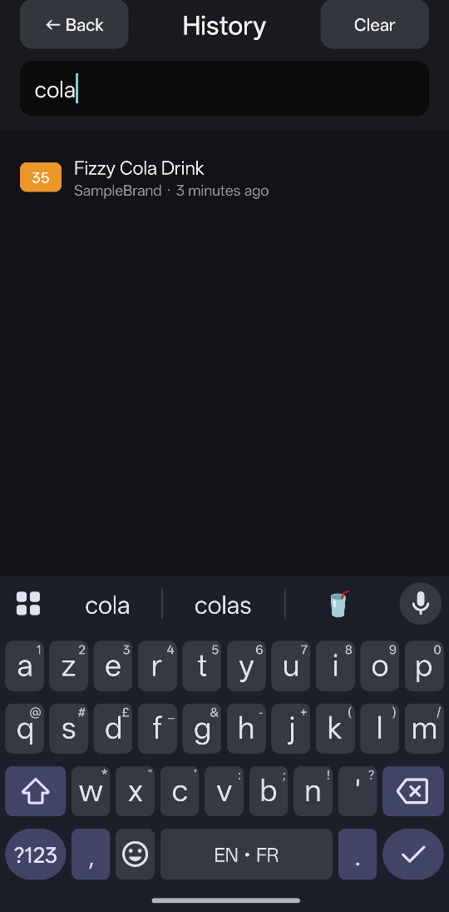

# HealthScan

An Android app that scans a food or cosmetic barcode and gives it a 0–100 health score,
explains what drives the score, and suggests healthier alternatives.

## Screenshots

| Home | Product result | Scan history | History search |
|:---:|:---:|:---:|:---:|
|  |  |  |  |
| Scan with the camera, type a barcode or name, or pick a sample. | Score, color scale, what's inside and better alternatives. | Every scan is saved on the device. | Find a past scan by name. |

## Features

- **Barcode scanner**: point the camera at an EAN-13, EAN-8 or UPC-A code, held upright or sideways.
- **Health score**: 0–100 on a red → green scale (Bad, Poor, Good, Excellent).
- **Breakdown**: nutrition (sugar, saturated fat, salt, fiber, protein), additives and organic
  label for food; ingredient hazards for cosmetics.
- **Better alternatives**: products in the same category that score at least 15 points higher.
- **Scan history**: searchable list of past scans, kept on the device.
- **Light and dark themes**.
- **Works offline**: a built-in sample catalog is used when there is no connection.

## How products are looked up

Barcodes are looked up only when you scan or search, in the open, community-run databases
[Open Food Facts](https://world.openfoodfacts.org) and
[Open Beauty Facts](https://world.openbeautyfacts.org) (data under the ODbL).
Their raw data is scored with HealthScan's own rules. See [MECHANICS.md](MECHANICS.md) for
the full scoring model and [mechanics.json](mechanics.json) for the values.

## Requirements

- Android 7.0 (API 24) or newer
- Permissions: **Camera** (barcode scanning only) and **Internet** (product lookup only)

## Build

You need JDK 17 or newer and the Android SDK (platform 34). Set `ANDROID_HOME`, or
create `local.properties` with `sdk.dir=/path/to/Android/sdk`.

```sh
./gradlew test            # unit tests (barcode reader, runs on the JVM)
./gradlew assembleDebug   # build/outputs/apk/debug/HealthScan-debug.apk
./gradlew installDebug    # install on a connected phone
```

You can also open this folder in Android Studio.

## Project layout

```
src/main/java/com/healthscan/app/
  MainActivity.java      home, search, result, alternatives and history screens
  ScannerActivity.java   camera preview and barcode scanning
  BarcodeDecoder.java    reads barcodes from camera frames (ZXing)
  OpenFacts.java         Open Food / Beauty Facts lookup
  Scoring.java           health score rules
  Catalog.java           offline sample products
  History.java           saved scans
  Product.java           product model
  ScoreViews.java        score disc and color scale
src/test/java/           JUnit tests
```

## Credits

See [CREDITS.md](CREDITS.md). The sample products are made-up placeholders.
